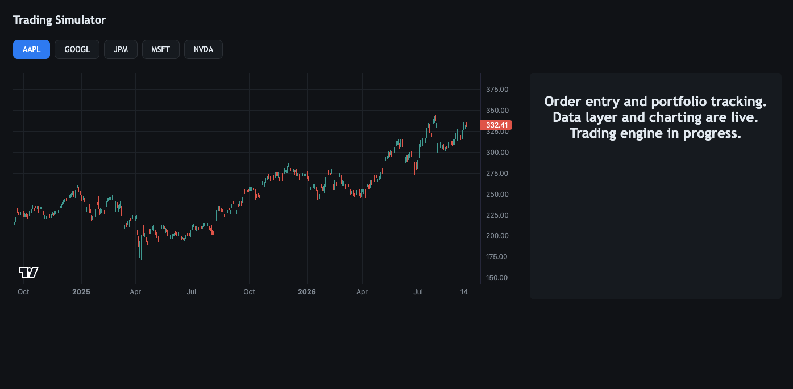

# Trading Simulator

A stock trading simulator built using real market data. 

Currently, it displays two years of daily price history for five US equties, data is pulled from Alpaca and stored in Postgres. 

**Live:** https://trading-sim.com/



## What it does

- Stores daily price price data for five US stocks, uses Alpaca as the data source
- Candlestick charts with the ability to switch between the stocks 
- Market data is kept seperate from the rest of the application, so switching the data source can be changed without rewriting everything around it
- Uses `Decimal` for prices instead of floats to avoid rounding issues

## In progress

I'm currently working on the trading engine and hash ledger. 

## Stack 

|||
|---|---|
| Backend | Django 6.1, Python 3.13 |
| Database | PostgreSQL (Neon) |
| Market data | Alpaca Market Data API |
| Charting | Lightweight Charts 5.2.1 |
| Hosting | Render, Cloudflare DNS |

## Hosting locally 

```bash
git clone https://github.com/DenysZ07/Trading-Simulator.git
cd Trading-Simulator

python3 -m venv venv
source venv/bin/activate

pip install -r requirements.txt

cp .env.example .env # then fill in your own values

python manage.py migrate
python manage.py backfill
python manage.py runserver
```

You will need an Alpaca API key. The free plan is enought to run the project. 

## Tests

```bash 
python manage.py test
```

The market data provider has a small set of tests that run against bith Alpaca and a fake provider. This makes it easier to add or change the data source without having to rewrite the tests. 

## Design decisions

See [decisions.md](decisions.md)